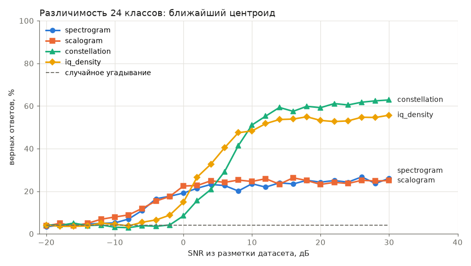
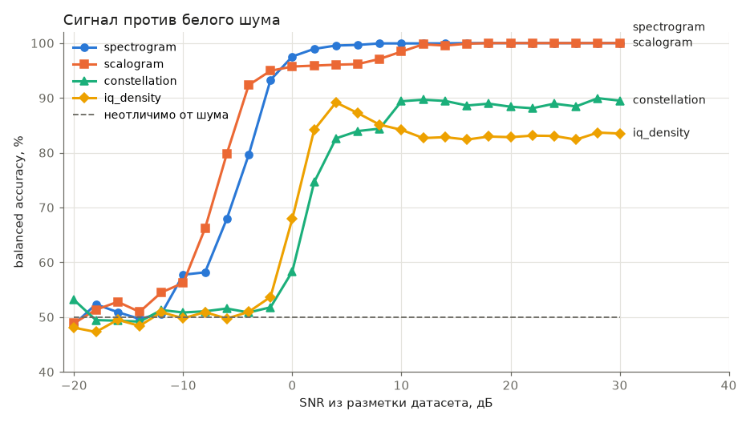
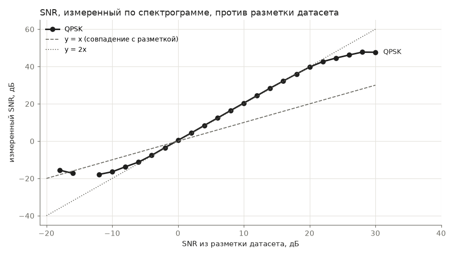
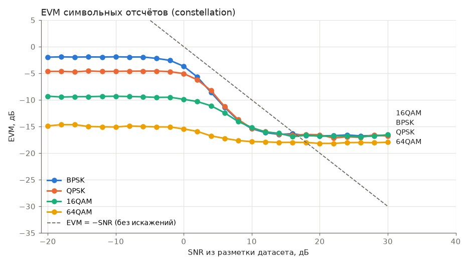

# Тестирование представлений (13.11.2026)

Проверялось, насколько корректно строятся спектрограмма, скалограмма и диаграмма
созвездия (а также вспомогательная плотность I/Q) для разных модуляций при разных SNR.

Как воспроизвести:

```powershell
py -m tests.test_transforms               # синтетические сигналы с известным ответом
py -m scripts.validate_representations    # настоящие данные; графики в results/validation/
py -m scripts.save_docs_images            # иллюстрации в docs/images/
```

## 1. Синтетические тесты — 19 из 19 прошли

Сигналы генерируются с известными параметрами: символы BPSK…64QAM, импульс
«приподнятый косинус» (β = 0,35), 8 отсчётов на символ, известный тактовый сдвиг,
белый шум с заданным SNR.

| Что проверяется | Результат |
|---|---|
| Формат | uint8 64×64, диапазон 0..255 у всех четырёх представлений |
| Инвариантность к амплитуде | ×37,5 → изображения совпадают побитово |
| Инвариантность к повороту фазы | спектрограмма и скалограмма не меняются (разница < 1e-4 дБ) |
| Ось частот спектрограммы | 11 тонов от −0,45 до +0,45 попадают точно в ожидаемые строки, положительные сверху |
| Ось времени спектрограммы / скалограммы | тон во второй половине сигнала виден только в правой половине (разница > 40 дБ) |
| Ширина полосы на спектрограмме | QPSK: 9 бинов по уровню −6 дБ (ожидается ≈ 8 = символьная скорость) |
| SNR по спектрограмме | от −5 до +20 дБ оценка совпадает с заданным SNR с точностью 0,16 дБ |
| Белый шум на спектрограмме | спектр плоский (неравномерность 0,16 дБ) |
| Ось частот скалограммы | 8 тонов 0,02…0,45 — в ожидаемых строках ±1, монотонно |
| Отрицательные частоты в скалограмме | не теряются, но **не отличаются от положительных** (свойство метода) |
| Созвездие без шума | BPSK, QPSK, 8PSK, 16QAM, 64QAM: тактовый сдвиг выбран верно 20/20, точки точно на местах |
| Созвездие с шумом | EVM = −SNR ± 0,5 дБ при SNR ≥ 10 дБ |
| Оси созвездия | I вправо, Q вверх |

**Известные ограничения, найденные тестами:**

- *Выбор тактового сдвига.* У приподнятого косинуса средняя мощность слабо зависит от
  сдвига (перепад ~10 %), поэтому при 10…25 дБ в 1–14 случаях из 30 выбирается соседний
  отсчёт. Средний проигрыш в EVM — 0,4–0,85 дБ относительно истинного сдвига.
- *Края спектрограммы.* При дополнении отражением на краях сигнала при SNR 30 дБ крайние
  столбцы вне полосы сигнала ярче середины на 2,5 дБ (на настоящих данных ~+56 единиц
  яркости из 255). Решение по исправлению не принято.

## 2. Настоящие данные (RadioML 2018.01A)

### Насколько различаются классы

Классификатор «ближайший центроид» (средние изображения 24 классов по train, проверка
на test) — не модель проекта, а грубая мера того, сколько информации о классе
содержит изображение. Случайное угадывание — 4,2 %.

| SNR, дБ | spectrogram | scalogram | constellation | iq_density |
|---|---|---|---|---|
| −10 | 5 % | 8 % | 3 % | 5 % |
| 0 | 19 % | 22 % | 8 % | 15 % |
| +10 | 24 % | 25 % | 51 % | 48 % |
| +20 | 24 % | 23 % | 59 % | 53 % |
| +30 | 26 % | 25 % | 63 % | 56 % |



- **Спектрограмма и скалограмма** при SNR ≥ +4 дБ выходят на плато ~25 %. Они хорошо
  отличают аналоговые сигналы (FM, AM) и ASK от остальных, но **PSK, APSK и QAM у них
  практически одинаковы**: при одной символьной скорости и одном формирующем фильтре
  спектр линейных модуляций одинаков. У спектрограммы при +30 дБ 16QAM, 16PSK, 128APSK, 256QAM — 0 % верных.
- **Созвездие** лучше всех при SNR ≥ +10 дБ: 16QAM и 16APSK — 100 %, QPSK — 79 %,
  FM — 100 %. Хуже всего QAM и PSK высоких порядков (128QAM, 256QAM — 31 %).
- **iq_density** при 0…+8 дБ различает классы лучше созвездия (в ней в 8 раз больше
  точек), а при высоком SNR — хуже.
- Матрицы ошибок: `results/validation/confusion_30dB.png`.

### С какого SNR изображение отличается от шума

Тот же классификатор на два класса: сигнал (любой класс) против комплексного белого шума.
50 % — неотличимо.

| Представление | неотличимо от шума | уверенно отличимо (> 90 %) |
|---|---|---|
| spectrogram | ≤ −12 дБ | с −2 дБ |
| scalogram | ≤ −14 дБ | с −4 дБ |
| constellation | ≤ −2 дБ | с +10 дБ (≈ 89 %, выше не растёт) |
| iq_density | ≤ −4 дБ | с +4 дБ (≈ 89 %, затем ≈ 83 %) |



Созвездие и iq_density не доходят до 100 % потому, что у QAM/APSK высоких порядков
«облако» точек похоже на гауссов шум, а центроид усредняет все классы.

### Разметка SNR в датасете

SNR, измеренный по спектрограмме QPSK (мощность над шумовым полом / шум), на участке
от −6 до +18 дБ разметки **ровно вдвое больше разметки**: измеренный ≈ 2 × SNR_разметки + 0,4 дБ
(−6 → −11,2; +10 → +20,4; +18 → +36,0). Тот же метод на синтетике даёт ошибку ≤ 0,16 дБ.
Независимо это подтверждает EVM созвездия: при разметке +6 дБ EVM QPSK равен −11,2 дБ,
что соответствует SNR ≈ 11 дБ. Ниже −8 дБ оценка упирается в погрешность метода, выше
+20 дБ — в динамический диапазон окна Ханна.



Вывод: шкала SNR в RadioML 2018.01A, по-видимому, не совпадает с отношением мощностей на
отсчёт (возможно, при генерации SNR применён к амплитуде шума как к мощности). Для работы это
важно при сравнении с литературой и при выборе SNR для графиков: «0 дБ» датасета —
это действительно 0 дБ, но «+10 дБ» — около +20 дБ, а «−10 дБ» — около −20 дБ.
Это наблюдение, а не установленный факт; документация датасета это не подтверждает и не опровергает.

### Созвездие: предел резкости

EVM символьных отсчётов при высоком SNR не опускается ниже −16,7 дБ (BPSK, QPSK, 16QAM)
и −18 дБ (64QAM), то есть ~14 % — точки размыты даже без шума. Проверено:

- тактовая синхронизация не виновата: дробная подстройка с шагом ¼ отсчёта улучшает EVM
  лишь на 2–3 дБ;
- согласованный RRC-фильтр перед выборкой (β = 0,2 / 0,35 / 0,5) делает EVM **хуже**
  (QPSK −16,7 → −13,8 дБ), так что гипотеза «размытие — от одного передающего фильтра»
  не подтвердилась;
- значит, размытие внесено каналом датасета (многолучёвость, замирания, дрейфы).
  Сетку 8×8 у 64QAM по одному сигналу получить нельзя.



## 3. Иллюстрации

`docs/images/` — 10 основных модуляций (OOK, 4ASK, BPSK, QPSK, 8PSK, 16QAM, 64QAM,
AM-DSB-WC, FM, GMSK): описание в [images/README.md](images/README.md).
